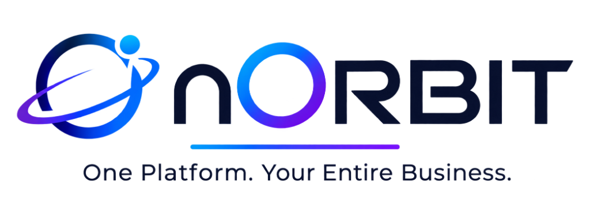
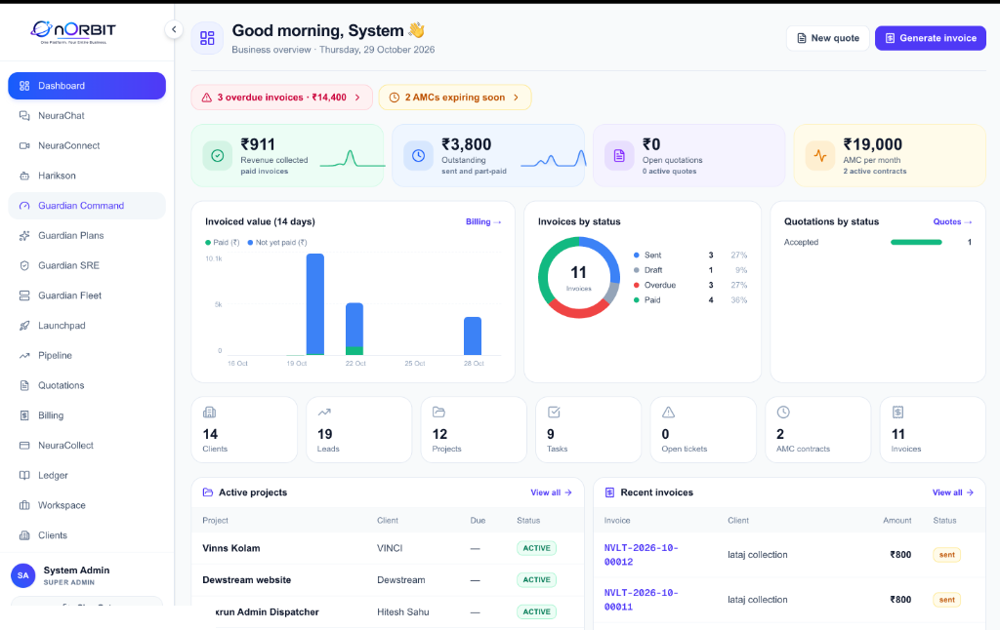
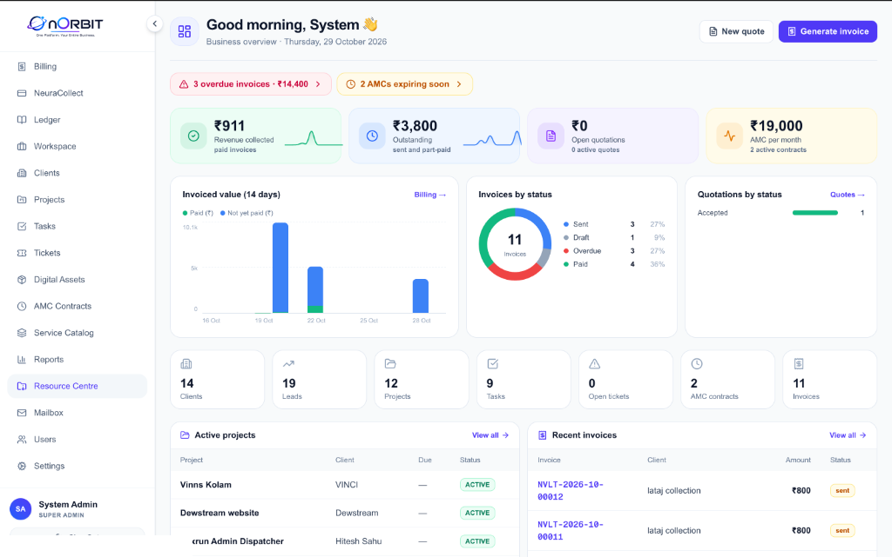

# nORBIT Community Edition

<p align="center">
  <a href="https://norbit.neuravolt.in">
    
  </a>
</p>

<p align="center">
  <strong>The Sovereign Autonomous Enterprise Operations Platform.</strong><br>
  Unified CRM, Agile Sprints, Kanban Tasks, and Helpdesk in a self-hosted, single-tenant Docker stack.
</p>

<p align="center">
  <a href="LICENSE"></a>
  <a href="https://github.com/neuravolt/nOrbit_community/stargazers"></a>
  <a href="https://norbit.neuravolt.in"></a>
  <a href="https://neuravolt.in/norbit"></a>
  <a href="https://teams.neuravolt.in"></a>
</p>

---

## 📸 High-Definition Visual Showcase

Experience a clean, Apple/Linear-inspired light interface designed for speed, clarity, and zero cognitive overhead:

### 1. Unified Operations & Metric Center
<p align="center">
  
</p>
<p align="center"><em>Real-time KPI telemetry, client deliverables, pipeline revenue, and team sprint velocity in a unified command center.</em></p>

### 2. Task Sprints, Workspaces & Telemetry
<p align="center">
  
</p>
<p align="center"><em>Agile Kanban boards, milestone checklists, and real-time activity streams with zero external SaaS dependencies.</em></p>

---

## 💡 Why nORBIT Community?

Most tech teams, agencies, and software companies burn **₹40,000 to ₹1,20,000+ every month** across 8+ fragmented SaaS subscriptions — Jira, HubSpot, Zendesk, Trello, and brittle Zapier webhook glue.

**nORBIT Community Edition** consolidates your daily agency operations into **One Sovereign Platform**:

| Core Pillar | Capabilities in Community Edition |
|---|---|
| 🎯 **CRM & Sales Pipeline** | Visual deal boards, interaction history, lead stages, and client directory. |
| ⚡ **Project Management & Sprints** | Time-bound milestones, deliverable tracking, and team sprint velocity. |
| 📋 **Agile Kanban Boards** | Drag-and-drop tasks, developer assignments, nested checklists, and priorities. |
| 🎫 **Community Helpdesk** | Client ticketing system, SLA response tracker, and bug triage. |
| 🐳 **100% Data Sovereignty** | Self-hosted on your own hardware or VPS with zero telemetry lock-in. |

---

## 🚀 Complete Step-by-Step Setup Guide

You can run nORBIT Community either using **Docker Compose (Recommended)** or via **Local Bare-Metal Development**.

---

### Method A: Docker Compose Deployment (Recommended - Sub-2 Minutes)

#### 1. Prerequisites
- [Docker Engine](https://docs.docker.com/engine/install/) (v24.0+)
- [Docker Compose](https://docs.docker.com/compose/) (v2.20+)
- Minimum Server Specs: 2 vCPU, 4GB RAM, 20GB SSD

#### 2. Clone the Repository
```bash
git clone https://github.com/neuravolt/nOrbit_community.git
cd nOrbit_community
```

#### 3. Configure Environment Variables
```bash
cp .env.example .env
```
Open `.env` in your editor and configure secure passwords:
```env
# Database Credentials
POSTGRES_USER=norbit_admin
POSTGRES_PASSWORD=generate_a_secure_password_here
POSTGRES_DB=norbit_community

# Security & Session Secrets
JWT_SECRET=generate_random_64_char_secret_key
JWT_REFRESH_SECRET=generate_random_64_char_refresh_key
ENCRYPTION_KEY=generate_random_32_char_hex_key

# Public App URL
NEXT_PUBLIC_API_URL=http://localhost:3001
```

#### 4. Launch the Entire Stack
```bash
docker compose up -d
```

#### 5. Verify Running Services
```bash
docker compose ps
```
Your instance is now live!
- 🌐 **Web Dashboard:** [http://localhost:3000](http://localhost:3000)
- 🔌 **REST API Engine:** [http://localhost:3001](http://localhost:3001)
- 📊 **PostgreSQL Database:** `localhost:5432`
- ⚡ **Redis Cache & Queue:** `localhost:6379`

To view live runtime logs:
```bash
docker compose logs -f
```

To stop the instance:
```bash
docker compose down
```

---

### Method B: Bare-Metal / Local Development Setup

#### 1. Prerequisites
- **Node.js:** `>= 20.0.0 LTS`
- **pnpm:** `>= 9.0.0` (`npm install -g pnpm`)
- **PostgreSQL 16:** Running locally
- **Redis 7:** Running locally

#### 2. Install Monorepo Dependencies
```bash
pnpm install
```

#### 3. Database Migration & Schema Sync
```bash
# Generate Prisma Client
pnpm db:generate

# Push schema directly to your local PostgreSQL
npx prisma db push
```

#### 4. Start Development Stack
```bash
pnpm dev
```
Turborepo will automatically spin up:
- `apps/web` on `http://localhost:3000` (Next.js Turbopack)
- `apps/api` on `http://localhost:3001` (NestJS REST API with Hot-Reload)
- `apps/worker` on `http://localhost:3002` (BullMQ offline processor)

---

## 🏗️ Monorepo System Architecture

```
nOrbit_community/
├── apps/
│   ├── api/             # NestJS Enterprise REST API (CRM, Projects, Tasks, Tickets)
│   ├── web/             # Next.js 16 Web Dashboard (Tailwind CSS, Lucide Icons)
│   └── worker/          # BullMQ background task processor
├── packages/
│   ├── shared-prisma/   # Shared Prisma Client and database bindings
│   ├── shared-types/    # Monorepo-wide TypeScript contracts and DTOs
│   ├── shared-config/   # Unified ESLint, Prettier, and environment configs
│   ├── shared-utils/    # Cryptography, string validators, and email helpers
│   └── shared-ai/       # AI inference wrappers (Gemini & provider routing)
├── prisma/
│   ├── schema.prisma    # Master relational PostgreSQL schema
│   └── migrations/      # Version-controlled SQL migration history
├── infra/
│   └── nginx.conf       # High-throughput production reverse proxy
└── docker-compose.yml   # Multi-container orchestration stack
```

---

## ⚖️ Community Edition vs. Enterprise Cloud

nORBIT follows the **Open-Core Model**. The Community Edition provides a robust, complete self-hosted foundation. For mission-critical infrastructure, autonomous cybersecurity, and enterprise compliance, **nORBIT Enterprise Cloud** delivers sovereign cloud capabilities:

| Feature & Capability | nORBIT Community (Self-Hosted) | nORBIT Enterprise Cloud |
|---|:---:|:---:|
| **License** | **GNU AGPLv3 (Free)** | **Proprietary Commercial** |
| **Hosting Model** | Self-Hosted Docker | Dedicated Sovereign Cloud |
| **CRM & Leads Pipeline** | ✅ Full Access | ✅ Full Access |
| **Milestones & Sprints** | ✅ Full Access | ✅ Full Access |
| **Kanban Task Boards & Checklists** | ✅ Full Access | ✅ Full Access |
| **Helpdesk & Ticket SLA** | ✅ Full Access | ✅ Full Access |
| **NeuraVolt Guardian Autonomous SRE** | ❌ | 🛡️ **Sub-2s Cyber Shield & Server Defense** |
| **AI Biometric Face Auth & Liveness** | ❌ | 👁️ **Hardware-grade 3D Face Recognition** |
| **Indian GST & Automated Invoicing** | ❌ | 💳 **Razorpay & Cashfree Automated Recurring ERP** |
| **Multi-Tenant White-Label Portals** | ❌ (Single Tenant) | 🏢 **Unlimited Dedicated Subdomains** |
| **Data Sovereignty & Backups** | Self-Managed | 🔒 **Automated Offsite Encrypted Snapshots** |
| **Support & SLA** | GitHub Issues / Community | 🚀 **24/7 Dedicated SRE & Guaranteed SLA** |

👉 **Explore Enterprise Cloud:** [https://norbit.neuravolt.in](https://norbit.neuravolt.in)  
👉 **Read Architectural Whitepaper:** [https://neuravolt.in/norbit](https://neuravolt.in/norbit)

---

## 📜 Licensing: Community vs. Commercial Use

nORBIT is dual-licensed to provide freedom for developers while protecting our enterprise ecosystem:

### 1. Open-Source Community License (GNU AGPLv3)
The source code in this repository is licensed under the **GNU Affero General Public License v3.0 (AGPL-3.0)**.
- **You are FREE to:** Self-host, inspect, modify, and run nORBIT Community for your own internal business operations.
- **Copyleft Requirement:** If you modify nORBIT and run it over a computer network (SaaS or hosted service), you **must make your full modifications open source under the AGPLv3**.

### 2. Commercial & OEM Proprietary License
If your organization requires:
- Running nORBIT without AGPL-3.0 copyleft obligations.
- Embedding nORBIT engines into closed-source commercial applications or OEM solutions.
- Commercial managed hosting, white-label branding, or multi-tenant sub-licensing.
- Dedicated enterprise warranty, indemnification, and priority SLA.

You can obtain a **NeuraVolt Commercial License**:
- ✉️ **Licensing Inquiries:** [licensing@neuravolt.in](mailto:licensing@neuravolt.in)
- 📞 **Enterprise Direct:** `+91 9202243725`
- 🌐 **Corporate Licensing Portal:** [https://neuravolt.in/norbit](https://neuravolt.in/norbit)

---

## 🏢 Corporate Information & Support

**nORBIT** is built and engineered with pride in India by **VOLTNOVATE SOLUTIONS LLP**.

- **Corporate HQ:** Anupam Nagar, Gwalior, Madhya Pradesh, India — 474011
- **R&D & Cyber Hub:** Sector 48, Gurugram, Haryana, India — 122018
- **Official Portals:**
  - SaaS Cloud: [norbit.neuravolt.in](https://norbit.neuravolt.in)
  - Internal Workspace: [teams.neuravolt.in](https://teams.neuravolt.in)
  - Corporate Website: [neuravolt.in](https://neuravolt.in)
- **General Inquiries:** [info@neuravolt.in](mailto:info@neuravolt.in)
- **Sales & Demos:** [sales@neuravolt.in](mailto:sales@neuravolt.in)

---

<p align="center">
  <sub>Copyright © 2026 VOLTNOVATE SOLUTIONS LLP. All rights reserved.</sub>
</p>
